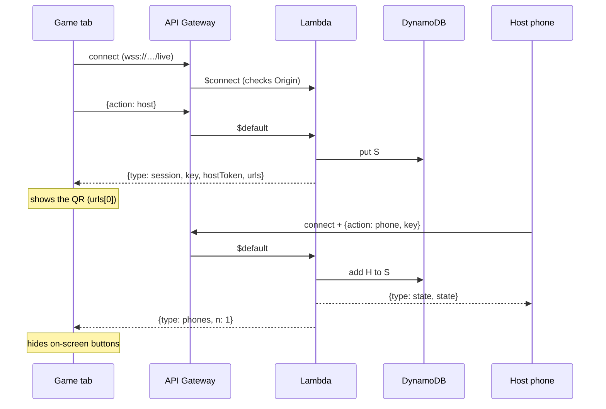
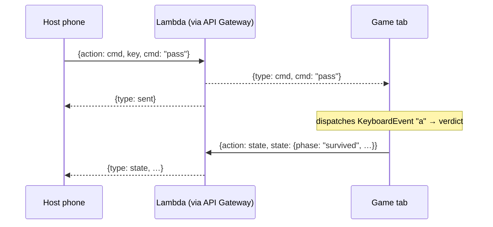
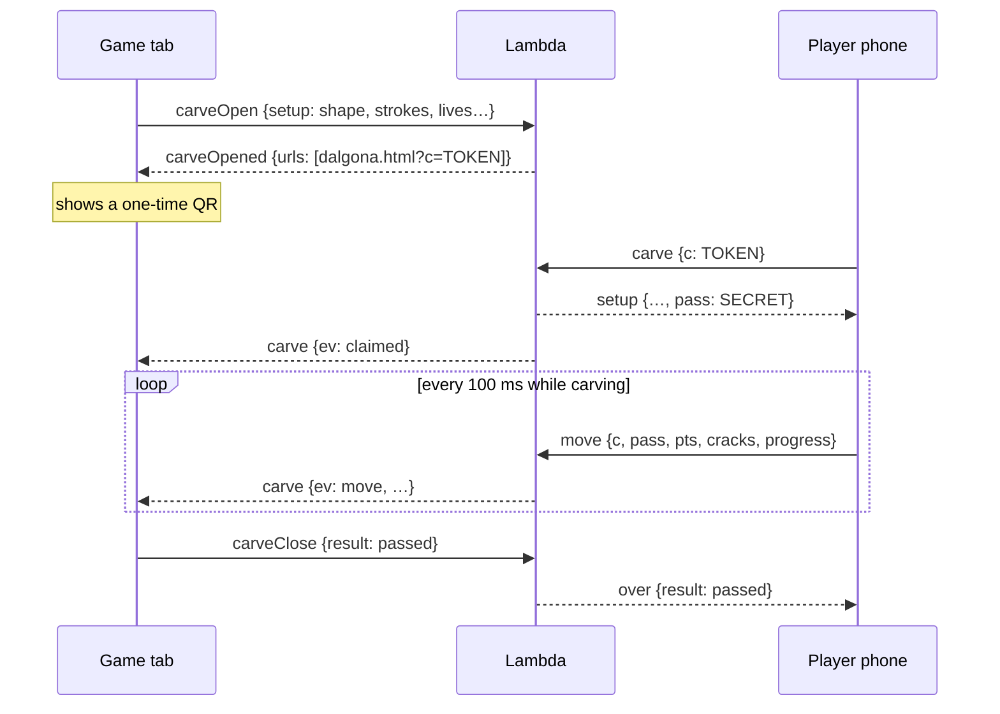

# How Squid Dare's phones talk to the game

This is the story of the phone remote and the dalgona carving: what we
needed, the options, what we built, and why. It's written to learn from, so
each part says what the moving pieces are and where to find them in the code.

- [1. The problem](#1-the-problem)
- [2. Why the first version needed a laptop](#2-why-the-first-version-needed-a-laptop)
- [3. Choosing a backend](#3-choosing-a-backend)
- [4. The architecture](#4-the-architecture)
- [5. One set of rules, two hosts](#5-one-set-of-rules-two-hosts)
- [6. The messages](#6-the-messages)
- [7. Walkthroughs](#7-walkthroughs)
- [8. What's kept in DynamoDB](#8-whats-kept-in-dynamodb)
- [9. Security](#9-security)
- [10. Living with API Gateway's limits](#10-living-with-api-gateways-limits)
- [11. The infrastructure as code (CDK)](#11-the-infrastructure-as-code-cdk)
- [12. The fallback: the laptop relay](#12-the-fallback-the-laptop-relay)
- [13. Dalgona: how carving is judged](#13-dalgona-how-carving-is-judged)
- [14. Cost](#14-cost)
- [15. Run, deploy, tear down](#15-run-deploy-tear-down)
- [16. Things to try next](#16-things-to-try-next)

---

## 1. The problem

The game runs in one browser tab on the big screen. Two kinds of phones need
to talk to it **live**:

| Who | What they do | Direction |
|---|---|---|
| **The host's phone** (remote) | Spin, stop the music, pick question or dalgona, pass, fail, next player; sees the answer | phone → game (buttons), game → phone (who's up) |
| **A player's phone** (dalgona) | Carves the candy with a needle; the big screen mirrors every scrape and crack | phone → game (10 updates a second), game → phone (the clock, the result) |

So we need messages going **both ways, instantly**, between devices that
can't talk to each other directly. Browsers can't open a connection to another
browser without help (WebRTC still needs a server to introduce them). We need
something in the middle: a **relay**.

## 2. Why the first version needed a laptop

The first relay lived **inside the Vite dev server** on the laptop: phones on
the same Wi-Fi opened `http://192.168.x.x:5173/...`, and the dev server
passed messages along (Server-Sent Events one way, `POST` the other).

That works, but only while:

- the laptop runs `npm run dev`, and
- every phone is on the **same Wi-Fi** (and the Wi-Fi lets devices see each other: office networks often don't).

And the public site, `hallowfin.vercel.app`, had **no relay at all**: Vercel
serves static files. Its serverless functions are short-lived (they time out,
and two invocations don't share memory), so they can't hold the long-lived
connections a relay needs.

## 3. Choosing a backend

| Option | Good | Not so good |
|---|---|---|
| Laptop relay (what we had) | Free, fastest on a LAN | Laptop must run; same Wi-Fi only |
| Hosted pub/sub (Ably, Pusher, PartyKit) | Least work | Someone else's service; our rules (host-only actions, one-phone claims) still need code somewhere |
| AWS AppSync Events | Managed channels, little code | Same: the rules need a Lambda anyway |
| A small server (Lightsail/EC2) | Closest to the old code | A machine to patch and keep running |
| **API Gateway WebSocket + Lambda + DynamoDB** ✅ | Nothing to keep running; pay per message; the classic serverless pattern | More pieces to understand (that's the learning) |

We chose the last one, and kept the laptop relay as a **fallback**, both
running the **same rules** (section 5).

## 4. The architecture

```mermaid
flowchart LR
  subgraph Browsers
    G[Game tab<br/>big screen]
    H[Host's phone<br/>remote.html]
    P[Player's phone<br/>dalgona.html]
  end
  subgraph AWS [AWS · ap-southeast-2]
    A[API Gateway<br/>WebSocket API]
    L[Lambda<br/>relay/lambda.js]
    D[(DynamoDB<br/>sessions · TTL)]
  end
  V[Vercel<br/>static site] -. serves pages + backend.js .-> G & H & P
  G <-- WebSocket --> A
  H <-- WebSocket --> A
  P <-- WebSocket --> A
  A -- $connect / $disconnect / $default --> L
  L <--> D
  L -- PostToConnection --> A
```

The pieces:

- **Vercel** serves the static site: the game (`index.html` + the React bundle)
  and the two phone pages (`public/remote.html`, `public/dalgona.html`). It
  also serves `public/backend.js`, one line saying where the relay is:
  `window.SQUID_WS = 'wss://…/live'`.
- **API Gateway WebSocket API** keeps every connection open. When something
  happens on a connection it calls the Lambda with a **route**:
  - `$connect`: a browser is opening a connection
  - `$disconnect`: a connection closed
  - `$default`: a message arrived (we don't use custom routes: the Lambda reads `action` from the message itself)
- **Lambda** (`relay/lambda.js`) is the relay. It's **stateless**: each call
  reads what it needs from DynamoDB, decides, writes back, and sends
  messages out.
- **Sending a message to a browser** is an API call: the Lambda calls
  API Gateway's **connections API** (`PostToConnection`) with the connection
  id. That's the key idea of WebSocket APIs on AWS: the connection lives in
  API Gateway, not in your code, so your code can be short-lived Lambdas.
- **DynamoDB** remembers sessions, who each connection is, and dalgona
  rounds. Every item has a `ttl`, so DynamoDB deletes it by itself after 8 hours.

## 5. One set of rules, two hosts

The heart of the design: **the relay's rules are one plain module** that
doesn't know where it runs.

```
relay/core.js        the rules: who may say what to whom
   ▲            ▲
   │            │
relay/lambda.js   tools/remote.js
(AWS: DynamoDB,   (laptop: a Map in memory,
 PostToConnection) a ws.send on each socket)
```

`core.js` exports `relay({ store, send, close, links })` and gets everything
from outside:

| Given | On AWS | On the laptop |
|---|---|---|
| `store.get/put/del` | DynamoDB `GetCommand` / `PutCommand` / `DeleteCommand` | a `Map` |
| `send(connection, message)` | `PostToConnection` (returns `false` on 410 Gone) | `socket.send` |
| `close(connection)` | `DeleteConnection` | `socket.close` |
| `links.remote(key)` / `links.carve(token)` | `https://hallowfin.vercel.app/remote.html?k=…` | `http://192.168.x.x:5173/remote.html?k=…&w=ws://…` |

This is **dependency injection**, or "ports and adapters": the logic sits in
the middle, and storage and transport plug in around it. What it buys:

- The two relays **can't drift apart**: a fix to the rules fixes both.
- The fallback came almost free: `tools/remote.js` is ~60 lines of plumbing.
- You can test the rules with a fake store and a fake `send`.

## 6. The messages

Everything is JSON with an `action`. Requests that expect an answer carry an
`id`, and the reply carries the same `id` (that's how `link.request()` in
`src/remote/link.js` matches answers to questions over one socket).

**From the game** (each carries `key` + `hostToken`):

| action | does | reply |
|---|---|---|
| `host` | open a session, or rejoin it after a drop | `session {key, hostToken, urls}` |
| `state` | what the phones should show (phase, player, question, answer) | (broadcast `state` to phones) |
| `carveOpen` | start a dalgona round | `carveOpened {urls}` |
| `carveTick` | the round's clock | (forwarded `tick` to the carver) |
| `carveClose` | the round is decided | (`over {result}` to the carver) |
| `end` | the tab is closing | (`ended` to every phone) |

**From the host's phone:** `phone {key}` (join) and `cmd {key, cmd}` (a
button: `spin`, `play`, `dalgona`, `absent`, `pass`, `fail`, `next`, `music`).

**From the player's phone:** `carve {c}` (claim the candy) and
`move {c, pass, pts, crack, cracks, progress, status}` (the needle, every 100 ms).

**Anyone:** `ping` (keeps the connection alive; see section 10).

On the game side, a phone's `cmd` becomes a **synthetic key press**
(`src/remote/useRemote.js`: `spin` → Space, `pass` → A, `dalgona` → D …), and
only in the phases where that key means something. So the phone runs exactly
the keyboard's logic, and there's no second code path to keep in sync.

## 7. Walkthroughs

### Opening the game and connecting the remote



### A button on the phone



### A dalgona round



### Closing the tab, versus a dropped line

These two look the same to the server (the socket closes), but they mean
different things:

- **Closing or reloading the tab ends the session.** The game listens for
  `pagehide` and sends `{action: end}` first; the relay tells every phone
  `ended` and deletes the session. The phones show OFFLINE, for good.
- **A dropped line** (Wi-Fi blip, laptop sleep, API Gateway's 2-hour limit)
  sends no `end`. `$disconnect` only clears `game` on the session. The game
  reconnects and sends `host` with its **saved key and hostToken**, so it gets
  the **same** session back, and the phones never notice.

## 8. What's kept in DynamoDB

One table, one partition key `pk`, three kinds of item (a **single-table
design**: the prefix says what it is):

| pk | holds | written when |
|---|---|---|
| `S#<key>` | `hostToken`, `game` (connection), `phones` (connections), `state`, `carve` (current round) | the game opens, state changes, phones join or leave |
| `C#<connectionId>` | `role` (game / phone / carver) and its key | a connection identifies itself |
| `K#<token>` | the round's `setup`, which `phone` claimed it, its `pass` | a dalgona round opens or is claimed |

Why `C#` items? At `$disconnect` API Gateway only tells us the
**connection id**. The `C#` item answers "who was that?", so we know whether
to update a session's phone count or tell the game a carver dropped.

Every item gets `ttl = now + 8h`, and DynamoDB's **Time to Live** deletes it
afterwards, so a crashed tab never leaves junk behind.

All access is by exact key (`Get`/`Put`/`Delete`), with no scans and no
indexes. Reads and writes are read-modify-write without locks; at party scale
(one game, a few phones) two writes racing on the same session is very
unlikely. A busier app would use `UpdateItem` with condition expressions.

## 9. Security

The relay is on the public internet and the repo is public, so:

| Threat | Guard | Where |
|---|---|---|
| Someone drives your session (changes state, ends it) | **Host token**: a secret only the game tab gets, required on every game action. It replaced the old "requests from this laptop only" check, which can't exist on a public server | `mine()` in `relay/core.js` |
| Someone guesses a session | Keys are 96 random bits (`randomBytes(12)`) | `token()` in `relay/core.js` |
| Someone scans the projected dalgona QR and carves for the player | **First phone claims it**: the round gets a `pass` secret, and moves without it are ignored | `carve` / `move` in `relay/core.js` |
| Another website uses our relay | **Origin check** at `$connect`: browsers always send `Origin`, and only our site and localhost are allowed (403 otherwise) | `relay/lambda.js` |
| Someone floods it | **Stage throttling**: 50 messages/s, bursts of 100. Messages over 24 KB are dropped | `relay-stack.ts`, `relay/lambda.js` |
| The Lambda has too much power | **Least privilege**: CDK grants read/write on this one table, and `ManageConnections` on this one API | `grantReadWriteData`, `grantManageConnections` |

Note what the origin check is and isn't: it stops other *web pages* from
using the relay; a script outside a browser can fake an `Origin` header. The
host token and the throttling are what really protect a session.

## 10. Living with API Gateway's limits

| Limit | Value | What we do |
|---|---|---|
| Idle timeout | 10 minutes without a message | Every client sends `{action: ping}` every 4 minutes |
| Max connection life | 2 hours | Clients reconnect on close; the game rejoins its session with the host token |
| Message size | 128 KB (32 KB frames) | Our biggest message (a dalgona shape's outline) is a few KB; the Lambda rejects anything over 24 KB |
| Cold start | ~1–2 s the first time after a quiet spell | Connect your phone a minute before the party starts |

The reconnect logic is in three places, all the same idea (on close, wait a
moment, open again, re-identify): `src/remote/link.js` (game),
`public/remote.html` (host), `public/dalgona.html` (player; it keeps its
carving and just gets a fresh `pass`).

## 11. The infrastructure as code (CDK)

All of AWS is described in `infra/lib/relay-stack.ts`. Reading it top to bottom:

```ts
const table = new Table(this, 'Sessions', {
  partitionKey: { name: 'pk', type: AttributeType.STRING },
  billingMode: BillingMode.PAY_PER_REQUEST,   // no capacity to plan: pay per request
  timeToLiveAttribute: 'ttl',                 // DynamoDB deletes expired items
  removalPolicy: RemovalPolicy.DESTROY,       // `cdk destroy` really removes it
})

const relay = new NodejsFunction(this, 'Relay', {
  entry: '../../relay/lambda.js',             // esbuild bundles it (4.7 KB)
  runtime: Runtime.NODEJS_22_X,
  architecture: Architecture.ARM_64,          // Graviton: cheaper per ms
  bundling: { format: ESM, externalModules: ['@aws-sdk/*'] }, // the SDK is in the runtime already
  environment: { TABLE, SITE_URL, ALLOWED_ORIGINS },
})
table.grantReadWriteData(relay)               // IAM written for you

const api = new WebSocketApi(this, 'Api', {   // all three routes → the same Lambda
  connectRouteOptions, disconnectRouteOptions, defaultRouteOptions,
})
new WebSocketStage(this, 'Live', { stageName: 'live', autoDeploy: true,
  throttle: { rateLimit: 50, burstLimit: 100 } })
api.grantManageConnections(relay)             // lets it PostToConnection
```

`infra/bin/app.ts` picks the region and the allowed origins and tags
everything `project: squid-dare`. CDK turns this into a CloudFormation
template (`npx cdk synth` shows it: try it, it's a good way to see what the
few lines above really create: roles, policies, permissions, integrations).

`npm run deploy` (in `infra/`) deploys, saves the outputs to `out.json`, and
`write-backend.cjs` copies the WebSocket URL into `public/backend.js`. Commit
that, push, and Vercel publishes it.

**Bootstrap** (`cdk bootstrap`, once per account and region) creates the S3
bucket and roles CDK uses to upload the Lambda's code. Our first attempt hit
an organisation policy that only allows one region, which is why the stack
pins `ap-southeast-2`.

## 12. The fallback: the laptop relay

`tools/remote.js` is a Vite plugin. In `configureServer` it attaches a
`ws` WebSocket server to the dev server's HTTP server, **only for the path
`/remote-ws`** (Vite's own hot-reload socket shares that server, so we leave
every other upgrade alone). Then it plugs a `Map` and `socket.send` into
`relay()`, and that's the whole relay.

How the game chooses (`src/remote/link.js`):

1. Try `window.SQUID_WS` (AWS); give up after 4 s.
2. Under `npm run dev` only, try `ws://<this host>/remote-ws`.
3. Neither? Try again in 5 s.

The links the laptop relay hands out carry `&w=ws://192.168.x.x:5173/remote-ws`,
and the phone pages use `w` when it's there, else `window.SQUID_WS`. So the
same two HTML files work with either relay. The remote card says which one
you're on ("any network" vs "same Wi-Fi").

## 13. Dalgona: how carving is judged

All the judging happens **on the player's phone** (`public/dalgona.html`);
the big screen only mirrors it, and the host can always overrule with Pass/Fail.

- **The shape** is a list of strokes in a 0–1 box (`outline()` in
  `src/game/dalgona.js`): the jack-o'-lantern is 5 strokes (shell, two eyes,
  nose, grin). It's turned into **checkpoints** every 0.008 along the line.
- **The needle's tip** carves, held 38 px above the fingertip so the finger
  never hides the line. Each move is walked in steps of 0.005, so a fast swipe
  can't skip over the candy.
- Each step **carves** any checkpoint within `HIT` (0.02) of the tip. If the
  tip is more than `OFF` (0.028) from the line, **strain** builds; at `STRAIN`
  (0.035) the candy **cracks**. Strain never heals.
- Moving more than `FAST` (0.07) in one event, or touching down off the line,
  is an instant crack. After a crack the candy **settles** for 0.9 s, so one
  slip costs one life, not three.
- **Cut out** means every checkpoint carved, with no run of more than 2 uncut
  in a row (a slip is forgiven, a gap never). Three cracks shatter the candy
  into 7 pieces (`shards()`), on both screens.

## 14. Cost

You pay only while it's used:

- **API Gateway WebSocket:** per million messages, plus per million connection-minutes.
- **Lambda:** per request, plus compute time (ARM, 256 MB, ~10–50 ms a message).
- **DynamoDB on demand:** per read and write; storage is tiny and expires.

A party is a few thousand messages and a few hundred connection-minutes: well
under a cent. Idle, it costs nothing beyond a few bytes of logs (kept 1 week).

## 15. Run, deploy, tear down

```bash
# play locally (uses AWS; falls back to the laptop if AWS is unreachable)
npm run dev

# deploy or update the backend (writes public/backend.js)
cd infra && npm install
AWS_PROFILE=<profile> npx cdk bootstrap      # once per account + region
AWS_PROFILE=<profile> npm run deploy
AWS_PROFILE=<profile> npx cdk diff           # what would change, before deploying

# watch the relay think
aws logs tail /aws/lambda/<function name> --follow --profile <profile> --region ap-southeast-2

# remove everything
AWS_PROFILE=<profile> npm run destroy
```

## 16. Things to try next

Good exercises, roughly from easy to hard:

1. **Read the generated template:** `npx cdk synth` and find the IAM policy
   CDK wrote for `grantManageConnections`. What resource ARN does it allow?
2. **Watch it live:** tail the Lambda's logs while you tap the remote, then
   open the DynamoDB table in the console and watch `S#…` items change.
3. **Add a metric:** log a line per `cmd` and build a CloudWatch Logs
   Insights query: "buttons pressed per minute during the party".
4. **Remove the race:** replace read-modify-write of `phones` with
   `UpdateItem` + `ADD`/`DELETE` on a string set.
5. **Unit-test the rules:** run `relay()` with a `Map` store and an array
   `send`, and assert the messages for "a second phone claims the candy".
6. **Alarm on errors:** a CloudWatch alarm on the Lambda's `Errors` metric,
   emailing you through SNS.
7. **A custom domain:** `relay.yourdomain.com` with an ACM certificate and an
   API Gateway domain name.
8. **Spectators:** a third phone role that only watches (the big screen's
   state, on your phone). It's a new `action` in `core.js` and a new page.
